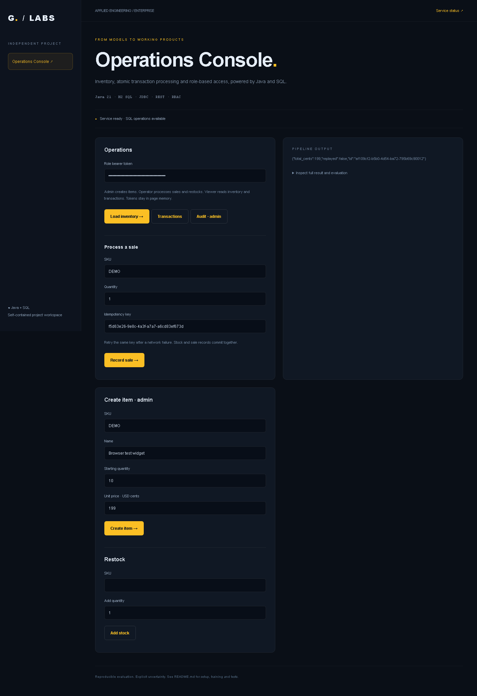
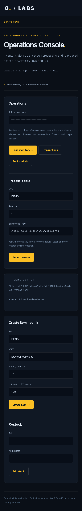

# Enterprise Business Operations Platform

[](https://github.com/morpheus-3/enterprise-business-operations-platform/actions/workflows/tests.yml)

## Screenshots



<details>
<summary>Mobile view</summary>



</details>


Independent Java 21 + H2 SQL + JDBC REST service with a browser operations console. Run all commands from this folder. No Maven installation required.

## Build and run

Set `$env:OPERATIONS_PORT = '8015'` before starting; open **http://127.0.0.1:8015**. Paste the configured role token into the UI to manage inventory, sales and restocks.


```powershell
powershell -ExecutionPolicy Bypass -File build.ps1
$env:OPERATIONS_ADMIN_TOKEN = '<unique random 24+ character token>'
$env:OPERATIONS_OPERATOR_TOKEN = '<different random 24+ character token>'
$env:OPERATIONS_VIEWER_TOKEN = '<another random 24+ character token>'
java -cp "target/classes;target/lib/*" Operations
```

Build downloads version-pinned H2 and Gson dependencies with Maven checksum verification; Maven installation is unnecessary. H2 persists SQL data under `target/operations`. JDBC uses parameterized queries. Tokens are SHA-256 hashed in the database and roles are refreshed from environment on startup. No default credentials. Service binds to localhost on port 8015. Put the matching role token into the operations page; browser memory only, no localStorage. Use an authentication gateway and HTTPS before exposing this baseline beyond a local demo.

| Endpoint | Method | Role |
| --- | --- | --- |
| `/inventory` | GET | viewer/operator/admin |
| `/inventory` | POST | admin |
| `/restock` | POST | operator/admin |
| `/transactions` | GET / POST | all read; operator/admin write |
| `/audit` | GET | admin |

Prices and totals are integer USD cents. Sales require `sku,quantity,idempotency_key`. Stock row locks, transaction rollback and request replay checks prevent overselling and duplicate decrements. Restocks and item creation are audited in the same SQL transaction. Reusing a key for different inputs is rejected. History and audit data persist across restarts.


## Tests

```powershell
java -cp "target/classes;target/lib/*" OperationsTest
py -3.10 -m pip install -r requirements-test.txt
py -3.10 -m pytest tests -q
```

Java tests cover exact cents, idempotency, oversell rollback, concurrent stock protection and transactional audits. HTTP tests launch the real Java service against a temporary database and verify authentication, RBAC and API validation. No AI is needed for transaction processing; this project has no model provider dependency.

The service defaults to port 8081 unless OPERATIONS_PORT is set. It serves the UI from `index.html`; launch it from this folder. H2 database files persist in `target/operations`. No default API tokens are included. Configure three distinct random 24+ character tokens. Use HTTPS and a proper identity gateway before external deployment.
